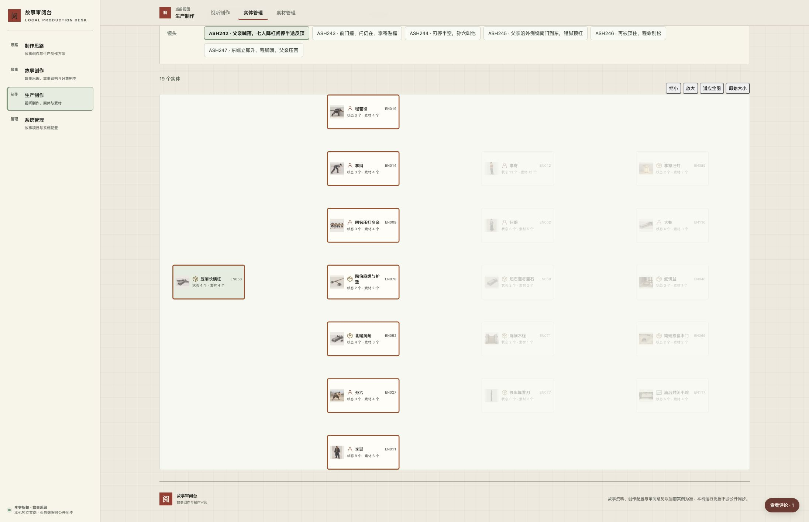
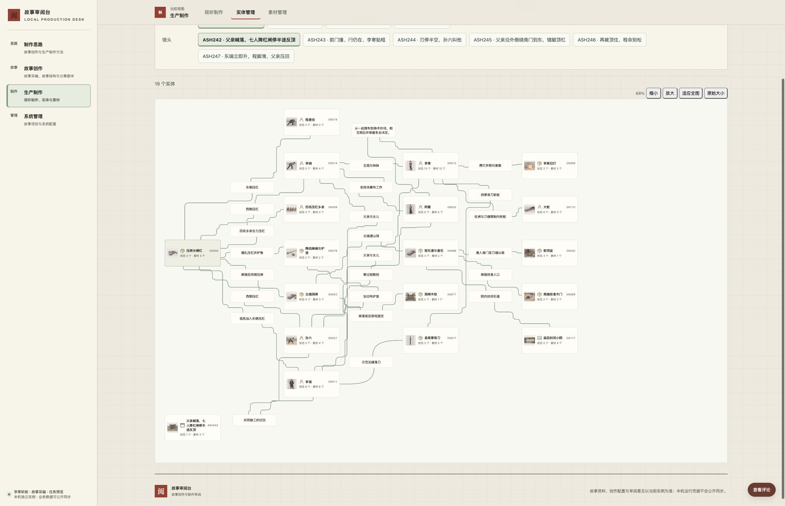
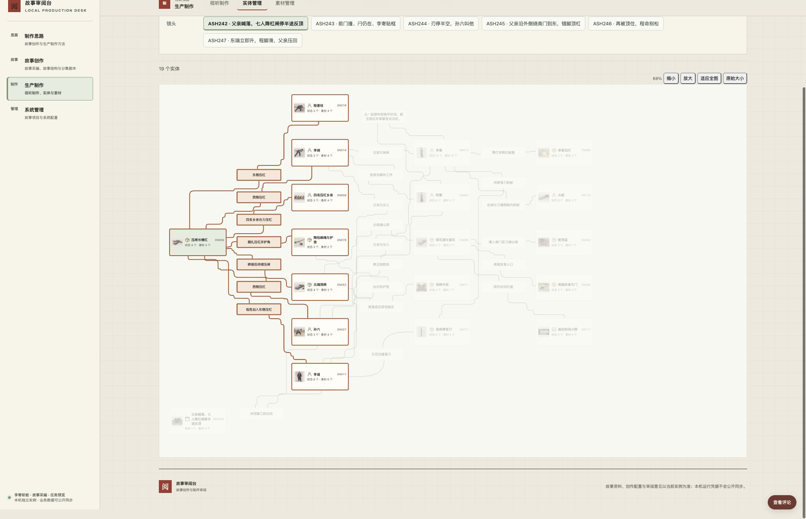

# 实体关系图完整绘制与故障恢复

task-20261012-0005 修复“有真实关系，却一条路线失败后整层连线消失”。AS046 的 ASH242、ASH243 在本次正式 Chrome 前例中均有19张卡、24条真实关系，页面连线和摘要为0；单击长杠仍能高亮七个直接邻居。ASH001 为15张卡、11条真实关系，是正常对照。这里的数量来自本次有效数据，不是产品常量。

## ASH242 前后

旧画面有节点和直连选择，却不能读出关系。下图逐字节保留任务输入的 JPEG，2192×1415、136,822字节，SHA-256 为 `b6180b96577ae77c121f7a335458ec8e9da58087c84ad0e776d8ec2e03fbfec1`；受管原输入仍在本任务 inputs。

改后全部24条真实关系进入图中，包括原失败的“县库厚背刀—李寄：持厚背刀斩蛇”。下图是本次隔离 Chrome 的最终源码画面；可以沿曲线看两端、读摘要，原始大小和平移用于局部阅读。

单击 EN058 只突出长杠、七个直接邻居及七条连接；两跳和邻居之间的其他关系保持可见。洞闸与长杠的“绑接后持续压闸”和洞闸与木栓的“闸落底后穿栓固定”均保留，分别在 Chrome 原始大小下实读；没有因当前镜头闸未落底删除后者。

## 实际修复

固定输入在旧算法的第11条关系失败：其中一段由 `[1135,926]` 到 `[1380,432]`，通路序号20。较远的绕行网格漏掉了障碍附近仍可通行的窄走廊，移除已占用线段也无法消除该缺口。新版同时保留近边界坐标与分离通路，完整计算原关系，不用穿卡直线或跳边兜底。

全量检查另发现 ASH012 的相邻摘要出口与早先路线共线。新版在所有卡片／摘要间分离出口轴，先预留全部短出口，再计算路线，覆盖“端口到外点”这一原先漏查的部分。必要交叉保留，真实方向、层级、循环、孤立节点和准确镜头范围沿既有契约。

绘制改为先完成所有几何和离屏图形，再一起替换连线、摘要、卡片尺寸及画布边界。同范围重排失败保留上次完整图、选择和视野，显示具体失败与“重新绘制关系图”；首次／新范围失败明确报错，不把部分图或旧范围伪装成成功。

关系图实现提交为 `b666b0345521ca05e18d85b94bb5a409bdc8cff0`；组合阶段回读主干后，`config/instance.json.review_desk_commit` 精确引用包含该实现的系统候选。最终双仓候选、主干／远端和正式镜像身份沿任务账本与本机冻结发布回执核对。

## 执行自验

| 范围 | 实际验证与结果 |
| --- | --- |
| 固定输入 | ASH242真实关系集合 SHA-256 为 `782684bd905ec94c9522f1130c104521e1e5b8bf9533d4d91218e6fccb1e7f2d`，与输入证据相同。原失败关系及全部端点、方向、摘要、路径逐项核对；ASH243同样完整。 |
| 全量几何 | 最新17集65场344镜，4,150次节点呈现、3,686次关系呈现；重复实体／关系按各镜分别计数。实际 Chrome 测量477张当前卡，宽230，高110或127。按这些尺寸检查完整集合、端点、方向、摘要、曲线采样避让、摘要与节点不重叠、画布边界及全部出口／路线不共用线段，344镜全部通过。旧算法同条件在68镜抛路由错误。自动检查不代替视觉阅读。 |
| 真实阅读 | ASH242、ASH243、ASH001、ASH344及新增端口反例ASH012；另实读旧算法失败的ASH025、ASH087、ASH187、ASH331代表图。两条机关阶段条件、原失败厚背刀路线、人物／道具关系和孤立节点可追踪。 |
| 选择与大卡 | EN058七条直连；洞闸切中心，同节点、空白、Space及Esc清除；孤立ASH344仅自身。EN052双击与Enter准确开卡，返回范围、100%视野、选择和原按钮焦点；ASH001阿蘅及ASH344镜头大卡往返。节点起拖只平移，不误选或开卡。 |
| 视野 | 原始大小、适应全图、放大／缩小、平移；390×844窄屏再放宽至2192×1415，完整边层稳定，原始字号下局部摘要可读。 |
| 路线故障 | 隔离Chrome精确注入通路序号20异常并实际触发ResizeObserver重排，24条完整关系保留且报错；解除后“重新绘制关系图”恢复。新范围同故障为0条绘制并明确失败，无旧选择／旧图冒充，解除重试恢复24条。最终源码重复验证同范围保护与窄屏恢复。 |
| 读取与迟到 | 隔离拦截图目录读取，页面显示读取失败和“重新读取列表”，旧图退出；解除后恢复。延迟ASH243真实响应，加载中改选AE001，随后放行旧响应仍为ASH001的15节点／11关系，旧选择不串镜；之后继续换镜、缩放、开卡返回。故障注入均已解除。 |
| 回归与保护 | 846项JavaScript、14项Python范围检查通过。定向夹具涵盖有向／反向、多父、循环、无向、孤立、共享端点多边、密集图和长摘要；绘制故障检查核对DOM身份、尺寸、选择与视野保持。隔离初始化基线与页面操作后46张表逐行摘要相等，403条评论及437条评论事件保留，没有业务写入。 |

数据集合和几何检查材料、浏览器逐边DOM与实际操作回执保存在本任务本机运行目录。绘图测试夹具只保存必要真实节点／关系投影，作为长期回归保留；不包含素材原件、用户意见或测试写入。

## 正式发布、恢复与收尾入口

沿 [受管工作区流程](../generation-workspaces.md) 完成 desk→primary 精确候选、提交引用／guard校验、必要推送及本机3000冻结包发布。纯界面发布不迁移业务，发布器逐表核对保全并固定镜像／源码、配置、挂载与回退依据。正式Chrome只读复走两失败图、正常对照及核心交互；完整Schema13导出在新空实例恢复后继续集场镜、选择和大卡往返，核对关系、候选、原件与评论。

正式发布、恢复和资源删除的实际结果归主项目 `.runtime/task-20261012-0005/` 与唯一 `.codex-task/tasks.json`，不以此说明的操作要求代替回执。发布后不修改已经交付的候选补写运行日志；代码候选变化须重新准备与复验。

执行自验由本任务承担，负责人独立复验另列开放结果，不代替旧任务独立复验或退役。过程服务、隔离库、缓存、重复导出和一次性脚本在正式验收／恢复完成后清理；必要前后图、数据摘要、Git、真实回执及正式当前／回退／基底镜像保留。双仓工作区在当前TUI退出释锁后由本任务收尾维护沿受管cleanup整组退役。

本次不含关系语义清理、创作设计改写、素材归属／跨页位置重做、付费生成或VPS发布。
