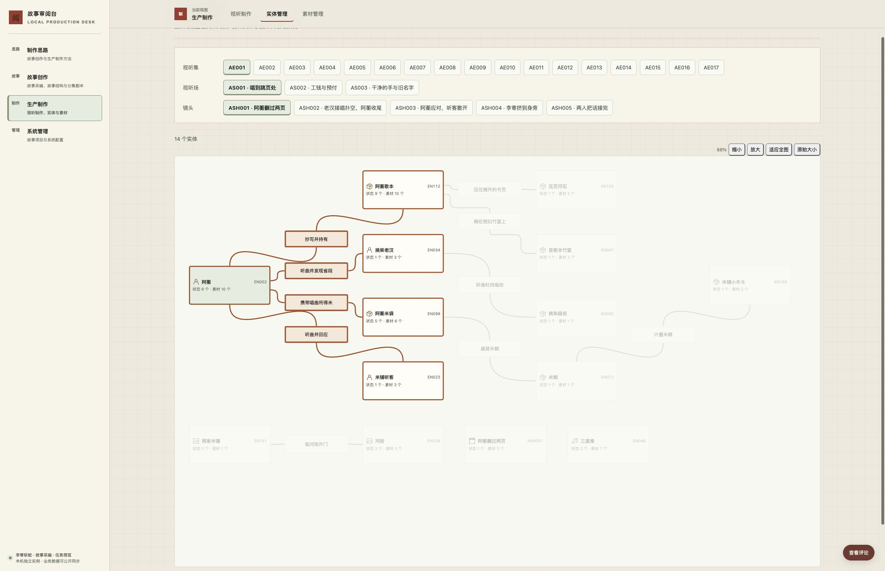
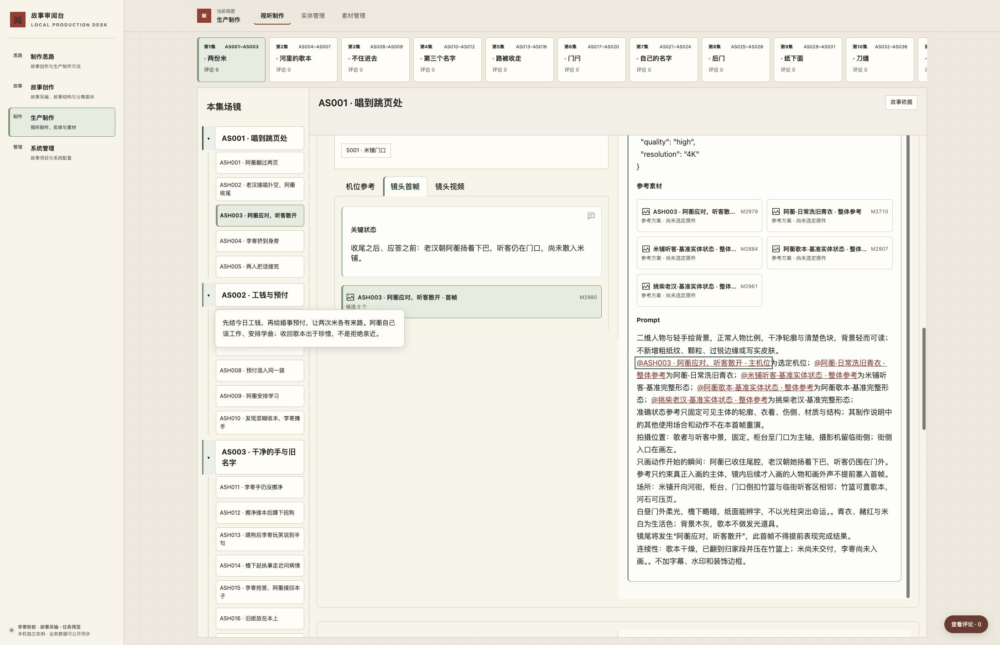

# 关系曲线、直连选择与 Prompt 引用验收

task-20261011-0006 修复两处阅读障碍：实体图原有关系共线、摘要拥挤，单击就离开图；首帧 Prompt 的关系浮卡遮挡正文。本次保留范围抽取、真实关系和准确素材版本，改变图的呈现及操作，并移除共用 Prompt 引用上的关系浮卡。

## 两个前后例

在 AE001 → AS001 → ASH001 中，原图的共同线段难以逐条追踪。现在每条真实关系使用分开的端点和平滑曲线，摘要保留在路径中；无向关联不添加箭头，孤立实体紧凑保留。单击阿蘅只突出阿蘅、歌本、米袋、老汉、听客及四条直连边；河石、竹篮、米斗不会随两跳关系被选。单击歌本切为阿蘅、河石、竹篮及三条边。第一次点击留在图中，双击或 Enter 才打开准确统一大卡；关闭回到原范围、视野、选择和焦点。

在 ASH003 → 镜头首帧 → M2980 中，原来的 `@ASH003…主机位` 弹出关系编号和操作浮卡，遮挡 Prompt。现在鼠标驻留、Tab 聚焦和 ArrowDown 均不弹出该卡；原引用仍打开 M2979 的准确修订，关闭返回 M2980 和引用焦点。参考小卡、原 Prompt、意见、模型约束及历史输入不变。

用户原始画面、原件身份及本次完整要求见 [任务交接](../../planning/relation-interaction-inputs/README.md)和[任务正文](../../planning/relation-interaction-task.md)。以上画面来自本次隔离 Chrome，正式画面及身份另存于下述运行回执。

## 执行验证

系统实现候选为 `e4a539d928f0730d526232e32a0e8c657b574e7f`。主项目通过 `config/instance.json.review_desk_commit` 引用该提交；准确最终双仓候选、主干、远端与正式镜像以任务账本及发布回执为准。

| 验证范围 | 实际结果 |
| --- | --- |
| 镜头范围 | ASH001 为14实体／10真实关系，ASH002为11／7，AS002的ASH006为10／9；切集、刷新、浏览器返回保持准确范围，旧高亮清除。数量由当前数据取得，未硬编码。 |
| 图的连续操作 | 阿蘅四边、歌本三边、孤立歌曲与ASH001只选自身；另一节点切中心，同节点、空白和Esc清除。Space选择、Enter打开、普通实体及镜头双击仅开一次，关闭恢复焦点和视野。摘要点击保持有用定位。 |
| 视野 | 桌面原始大小、适应全图、放大缩小、窗口变化及400px窄屏实操；从节点开始拖动后仅平移，没有误选或开卡。选择不重排图。 |
| Prompt 当前方案 | M2980的鼠标、Tab、ArrowDown、点击和Enter实操；准确打开M2979修订 `8b94f1c07935c43d27cf4e9eb380c990295b60b0df9ea21b08af341a206c864d`，返回首帧与焦点。 |
| 统一大卡与素材入口 | 素材M841当前方案引用M001修订 `36558137a778bd0517faf7a8db7234ac43b53438737bdfc2b50dbfb8a8217e39`；候选1保留真实历史输入 `d4ca874bc9cd326fea61d92d5cbd4e05d80903de4827f6e5c7312e9b9120c4ef`，Enter准确打开其17秒原件入口，关闭仍在候选1。没有试听或音质结论。 |
| 评论草稿 | 在隔离M2980圈选原文并填写草稿，打开参考后返回保留原对象、范围及文字；最后取消草稿，没有写入正式评论。 |
| 读取失败 | 隔离Chrome阻断图目录读取，旧图不冒充新范围，解除后“重新读取列表”恢复；阻断准确Prompt目标读取，解除后重开恢复M2979。 |
| 目标失效与异步 | 准确对象／修订请求返回404时明确不可用，不回退最新版；重开后恢复。延迟ASH001后切ASH002、延迟M841后开M1069再放行旧响应，页面仍保持后选范围／素材。 |

自动检查与实际页面验收分别记录：837项JavaScript测试全部通过，其中七项专项检查覆盖有向／反向、多父、真实环、无向连通、孤立节点、共享端点多边、密集图、实际卡高及长摘要；采样曲线不进入卡片或摘要，不共享直线段。Prompt专项检查保留准确对象、修订、候选、组成、范围与Unicode原文位置映射。37项Python范围／关系／展示检查通过，另两项隔离HTTP写入保护检查确认过期发布凭据拒绝写入、有效凭据正常写入。未用自动检查代替上述Chrome操作。

## 数据与完整恢复

本次无业务迁移，没有修改作品、Prompt、素材方案或关系意见。隔离初始化前后逐表核对既有数据，包括5,850条业务关系、9,333条当前记录、328份提交／候选快照、362项目标、403条评论和437条评论事件；原件与真实调用沿原身份保留。

完整Schema 13导出在新空实例恢复：9,517个对象、9,243个制作对象、9,643份修订、403条评论，验证1,020份文件。恢复后再次导出，完整manifest相等，全部1,020份文件字节哈希相等。恢复Chrome继续ASH001直连选择和双击返回、AS002／ASH006切换，以及ASH003／M2980 → M2979 → M2980往返；ArrowDown不出现关系浮卡。没有用任务数据库覆盖正式活库。

## 正式交付、独立复验与收尾

本任务沿受管双仓候选、准确引用约束、集成和必要推送交付，再通过现有冻结发布脚本切换本机 `http://127.0.0.1:3000/`。纯界面发布须逐表保全正式库，并回读提交、配置、镜像源码、挂载与回退依据；Git送达或服务健康不能单独代表页面验收。

正式发布后的Chrome、准确完整导出身份、清理数量及实际删除回读，归主项目 `.runtime/task-20261011-0006/` 和唯一 `.codex-task/tasks.json`。本文件保存已实施的交互及本次隔离证据，不预先声称正式发布成功。候选交付、正式发布、执行自验分别登记；原负责人独立复验保持单独待办，不恢复持续Review，也不替旧任务改写验收。

过程服务、重复导出、隔离数据库及缓存在正式验收后清理；正式当前／回退镜像、永久发布包、受管原件和最小恢复证据保留。两处worktree仍由本TUI和清理锁占用，退出释锁后由本任务收尾维护通过 `codex.project task cleanup` 整组退役，保留Git分支与会话历史。实际资源处置只能以回执为准；其他任务和共享资源不在本次清理范围。

本次不含VPS发布、付费生成、音视频效果认可或正式创作内容改写。旧M1069引用缺失等数据问题未由本任务修补；其原归属保持。
