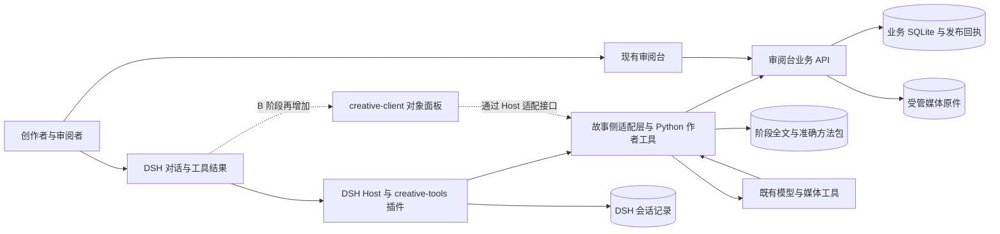
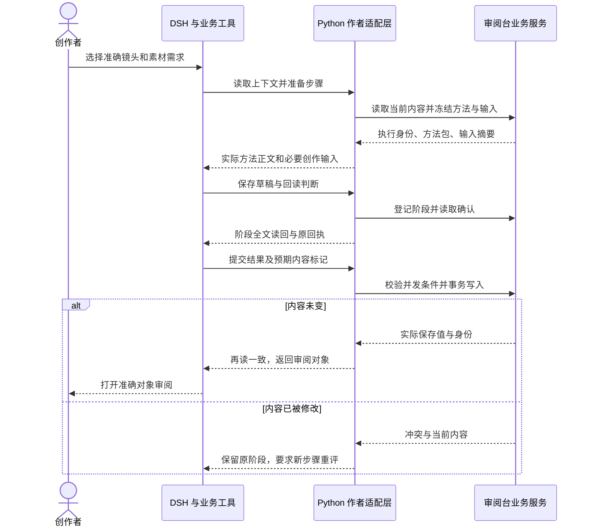

# 当前系统融入 DSH：实现成本与推荐架构

任务：task-20261012-0020。供熟悉业务后端、尚未深入 DSH 的工程师决定是否投入接入。本文是调研和设计建议，不代表已实施、已实测接入或已批准迁移。

## 1. 建议先接执行层，保留创作与审阅的数据基础

**值得做一个小范围验证；建议采用“DSH 执行插件＋现有 Python 创作工具和审阅台”的架构，暂不整体迁移。** DeepSeek Harness（DSH）是智能体运行框架，可以承接模型对话、工具调用、会话恢复和插件界面。当前系统已经拥有较完整的影视创作业务约束：作品与场镜、实体关系、准确素材、方法历史、阶段原稿、评论依据及发布回执。这些约束仍需由业务代码负责。

建议按以下投入阶梯决策。人日是一个工程师一个有效工作日的工作量；表中为**从零累计到该终点**的估算，不能把各行相加。范围与拆分见第 6 节。

| 可选终点 | 工程投入 | 得到什么 | 本次建议 |
| --- | ---: | --- | --- |
| 最小验证接入 | 6–11 人日 | 单个镜头方案、准确方法、阶段保存、原审阅页返回和中断重读 | 优先验证，设退出门槛 |
| A：保留现有系统，日常连接 DSH | 23–38 人日 | 常用作者流程与评论修订可通过 DSH 完成，业务审阅继续使用现有页面 | 推荐首个日常版本 |
| B：DSH 插件统一工作入口 | 45–75 人日 | 在 A 的业务基础上增加 DSH 原生对象面板、反馈与结果卡片 | A 证明价值后再决定 |
| C：业务与界面整体迁入 DSH | 106–178 人日 | 重写业务服务、完整审阅界面和历史迁移，逐步退役现有服务 | 当前不推荐 |

判断依据有三点。第一，DSH 的插件与工具接口适合接入现有业务服务，不要求把 Python 改写成 TypeScript。第二，现有系统最有价值的部分是跨对象的一致性与可追溯性，无法通过复制提示词或会话记录自动获得。第三，本次读取的 DSH 工作流不保存中间进度，默认后台任务也不跨进程持久化；长时间生成和断线恢复仍需业务层的操作记录。[D1–D5、S2–S5，见第 9 节]

这条路线的收益假设是：减少人在创作工具、上下文和审阅页之间手工搬运材料，并让 AI 沿准确方法继续工作。**没有证据证明仅换运行框架就能改善作品质量、减少生成费用或加速现有页面。** 如果试验没有减少交接失误和人工步骤，继续使用当前工具即可，不必因已完成试验而推进 B。

## 2. 调研版本与现状边界

源码与任务状态截点为 **2026-10-13 00:43（Asia/Shanghai）**。以下是准确研究输入，不以分支名代替版本。`S` 表示故事仓，`R` 表示审阅台仓，`D` 表示 DSH 仓；后文源码路径相对各自仓根。

| 来源 | 定位 | 本报告基线 |
| --- | --- | --- |
| S：故事项目 | 本文所在仓库根 | 主干 `65701df68e2db7a88225c446af829c05036c24d7`；研究分支已合入该主干，合并提交 `902e33a692d0711399a4c4c71110711e93fc18e0` |
| R：通用审阅台 | 相对故事主项目的 `../story-review-desk`；读取时只读 | `45cb41bd1ff00d993c4b9351be3bc1cbdc2df830`，与故事 `config/instance.json.review_desk_commit` 相同 |
| D：用户指定 DSH | `~/repo.pub/github.com/goosmanlei/deepseek-harness`；读取时只读 | `639ed015397290b3745d163aafe02ffee4aa3f84`，本地 `master`；不声称为上游最新 |

故事本地主干包含已读取的远端 `a8cbdc9dd0ae891bbebe299bdbf32fb127e70db4`，并有后续组合候选。配置引用只说明源码组合，不能证明当前服务已运行该组合。本次没有连接正式数据库或检查正式页面，因此下文“已有”指源码契约及已读交付文档，不宣称全部经过本次运行验收。

截点时，0016 素材分类任务仍为 running；其九类分类、方法选择和方案修改已经进入所读源码，正式发布收尾仍由原任务核验。0019 关系图任务已 completed，账本有 Git、正式发布和验证成功记录，独立 Review、剩余交叉及工作区退役等仍单列。0017 制作导航、0018 VPS 部署为 published，未把它们的目标算作已具备能力。本报告不等待、接管或关闭这些任务。

官方上游在 2026-10-13 查询时仍标为开发者预览，并明确存在破坏兼容性的变化。因此接入应锁定版本、集中适配边界，不以自动追随上游为日常发布策略。[官方说明](https://github.com/deepseek-ai/deepseek-harness#developer-preview)

## 3. 当前能力如何落到 DSH

当前系统的分工是：故事仓维护创作方法、作者流程与制作交接；通用审阅台使用 Python HTTP 服务和 SQLite 保存、展示、评论与管理业务数据。SQLite 是嵌入式关系数据库。AI 负责生成和判断，审阅台不反向依赖故事作者工具。[S1、R1]

下文 UI 指用户界面，API 指程序调用接口，CLI 指命令行入口；Skill 指可供 AI 读取的工作方法包。工作流编排负责组织步骤，持久化负责把必要记录保存到进程退出后仍可读取的位置，两者不能互相替代。

表中的“直接复用”指接入后继续使用现有模块，并非 DSH 原生提供同名业务功能；“连接”指新增工具或接口包装；“重写”主要发生在路线 C。

| 业务能力 | 当前可核实的实现 | DSH 能提供什么 | 推荐处理与缺口 |
| --- | --- | --- | --- |
| 故事、场、镜与实体、状态、关系 | `production.py` 的对象导入与引用校验；统一关系和视听模型；关系图展示 | 工具、会话上下文、可扩展面板 | 直接复用业务模型；连接按镜头取得有限上下文的工具。DSH 未提供本项目的场镜与关系语义 [R1、S1、D2] |
| 唯一素材需求与当前方案 | `production_current.marker/guard` 维护编辑令牌和内容摘要；`material_categories` 按九类决定方法 | 工具参数校验、调用策略 | 保留当前方案写入与分类规则。仅有对象 ID 或固定 `revision_id` 不足以判断当前内容是否变化 [R2、R3] |
| 准确参考、候选与原件 | 准备包含有序原件、部件、SHA-256 内容指纹、裁切或时间段；提交时冻结方案，结果归属真实调用 | 可显示文件与工具结果 | 原件继续存现有媒体目录，DSH 返回受控引用。附件、模型生成文字、预览卡片均不能自动成为业务候选 [R3、S4] |
| 评论、修订与历史 | 原评论位置、当时摘录及当前匹配状态；处理证据与评论版本并发校验 | 将反馈送入下一轮模型输入、呈现操作结果 | 连接准确评论包和处理回执；原审阅 UI 直接复用。会话内一句“已修复”不能关闭业务意见 [R4、D2] |
| 方法文件历史与执行依据 | 文件按原字节独立计版；`methods.prepare` 冻结方法、绑定、输入与文件清单 | Skill 提供发现、读取和提示注入 | 保留业务方法权威；包装“取准确方法”工具。DSH 文件 Skill 每次读取当前正文，不等于冻结执行 [R5、D3] |
| 作者阶段保存、回读与恢复 | `method_runtime` 同时核对服务摘要、本机阶段全文和原执行；`video_prompt_work.finish` 保存后再次读取 | 持久会话、下一轮模型输入、短流程编排 | 直接复用检查点，补接跨进程定位。DSH workflow 与默认 jobs-local 不提供该恢复保证 [S2、S3、D4] |
| 模型与媒体调用 | `generation_operation.before_submit` 先登记准确提交；`production_operations` 保存重复操作、未知状态及结果 | 模型循环、工具注册、取消、后台任务接口 | 连接现有提供方工具；补全恢复时的查询协调。业务回执可重放，不代表外部供应方请求能“恰好一次”执行 [S4、R3、D2、D4] |
| 正式发布与灾难恢复 | 准确增量、事务内发布凭据、完整导出和新空实例恢复流程 | 插件部署和会话存储 | 保留现有发布路径；候选创作、用户采纳、正式发布维持不同动作。DSH 安装成功不代替作品发布 [S5、R1] |

几个容易高估的复用点需要单独说明：

- **DSH 会话日志保存模型所见的交互。** 核心会话默认在内存，须装配持久后端、建立活动写入句柄，必要时等待 `flush` 落盘检查点，才能依赖跨进程恢复。它适合恢复对话，不负责维护跨素材的事务、评论版本和提交时输入。重要工具结果需进入会话，但全文业务资产继续由业务存储负责。[D1、D2、D8]
- **DSH 非会话存储目前提供键值接口。** 已读 `KvUnit` 契约保证单次操作原子且持久，未暴露调用者可组合的多记录事务；领域层加载单元数据进入内存。SQLite 后端存在版本校验，不能据此推断具备现有数据结构第 14 版（Schema 14）的历史迁移和恢复语义。它适合小规模项目指针、偏好及会话映射，不能原样替换当前业务库。若选择 C，应另建拥有关系数据库事务的业务插件；DSH 允许扩展，不代表这部分业务已经实现。[D5]
- **DSH 界面可扩展，但不是把旧页面源码放入插件就完成迁移。** Client 是浏览器侧插件，Host 是运行工具和服务的进程；二者通过明确接口通信。布局有 `main` 面板插槽，工具 Web 卡片另需注册；Host 的展示声明不会自动生成专用 Web 卡片。B 因而需要前端工程和重连处理。[D2、D6]

## 4. 三条路线的取舍

比较范围均为第 3 节的创作、方法、素材、评论、历史与恢复能力；差别是由谁承载，而非通过删去历史功能降低迁移报价。最小验证则有意只覆盖两个代表场景，不等于完成全部范围。

| 维度 | A：连接执行能力 | B：插件统一入口 | C：整体迁入 |
| --- | --- | --- | --- |
| 用户工作 | 在 DSH 发起/继续创作，原审阅页看作品、评论、候选 | DSH 内有业务对象与审阅入口，深度编辑可逐步原生化 | 全部业务操作在新界面完成 |
| 复用范围 | Python 业务、作者方法、数据、审阅 UI 几乎全部保留 | 后端、数据、方法保留；新增常用工作面板和结果卡片 | 业务规则需重实现；方法文件与原件可迁入，旧服务最终退役 |
| 侵入与部署 | 新增 DSH 进程及薄适配；现有服务职责不变 | 同时维护 Python 服务、DSH Host 和 Client 构建 | 仍需专门业务数据库与原件存储；语言统一不等于单进程或零运维 |
| 升级耦合 | 集中在工具、会话和配置边界 | 再耦合面板插槽、浏览器通信、前端状态 | 大部分业务发布与 DSH 插件运行环境绑定 |
| 历史成本 | 不搬业务历史；新增执行映射 | 不搬业务历史；设计导航和上下文映射 | 全量迁移及逐项语义核对，保留旧 ID、评论位置、方法文件与调用依据 |
| 退出成本 | 停用插件，从原作者目录与审阅台继续 | 停用新界面，回原 UI；新数据仍在原业务库 | 需反向迁移或长期双系统兼容，最高 |
| 适用条件 | 优先打通 AI 执行、可接受跨页审阅 | 已证明 AI 闭环有效，跨页确为主要使用障碍 | 明确要退役 Python/原 UI，且能承担全量迁移与维护 |

**推荐 A，架构上给 B 留接口。** “统一入口”不应成为先改写所有业务模块的理由。若产品目标本来就是只用现有审阅页，也可通过 DSH 的 Python SDK（供 Python 调用 DSH 的开发包）启动同版本子进程。已读 SDK 使用具名 `sdk` 配置和独立运行目录，可返回会话事件与最终结果；这是一种可选部署方向，不与推荐的“DSH 主导会话、调用业务工具”同时叠加，避免双重调度。[D7]

## 5. 推荐架构与交接契约

以下是设计方案，组件名中带 `creative-*` 的均为拟新增插件，不是已有 DSH 包。

### 5.1 组件组成与改造范围

DSH 使用 Cordis 组织插件；Cordis 的作用是声明依赖、注册服务，并在插件卸载时释放资源。建议以独立插件包接入，通过具名 profile（启动配置组合）和 bundle（插件集合）装配，不修改核心模型循环。锁定 DSH、插件与 Client 构建的准确版本；项目运行目录与个人默认 DSH 目录分离，退出插件时释放监听器与本任务子进程。[D1]

首期从现成 `web` 启动组合扩展业务工具，核对模型、工具、会话及持久后端实际挂载；只做后台调用时选择 `headless`，由 Python 发起时选择前述 `sdk`。启动配置仅保存实例标识、业务服务地址和工作目录等非敏感定位；模型凭据沿现有凭据机制，不放进方法正文、工具结果或版本库。业务服务地址来自明确配置，不接受模型任意更换目标。

| 组件 | 首期职责 | 保留、包装或新增 |
| --- | --- | --- |
| `creative-tools` Host 插件 | 注册读取上下文、准备步骤、阶段回读、提交结果、读取意见和查询操作的结构化工具 | 新增；工具以 `defineTool` 声明参数与 JSON 结果，校验跨字段业务限制 |
| 故事侧适配层 | 把工具输入转为现有 Python API/CLI 调用；限制实例、工作目录和操作范围；返回准确业务身份 | 新增包装；复用 `method_runtime`、`media_method`、视频/小说/剧本作者入口 |
| 通用审阅台服务 | 继续负责对象、事务、评论、方法历史、候选与完整导出 | 保留；仅在现有 CLI 能力缺 HTTP 入口时补通用端点，不能反向导入故事创作代码 |
| 方法获取 | 按工作类型、素材分类、条件获取冻结包；把本次所需正文给模型 | 首期用业务工具；后续可实现 DSH Skill provider 作发现入口，但执行仍固定业务包 |
| `creative-client` | 展示所选对象、最新阶段、结果和回原审阅页入口 | B 才新增；使用 Client 模块清单、`main` 插槽和 Host 接口，不从浏览器直接读取 SQLite |
| 发布与恢复工具 | 精确增量、媒体哈希、回执、空实例恢复及正式资源协调 | 保留现有流程；普通创作工具不能顺带自动发布正式库 |

首期优先让适配层通过已有 HTTP 接口交接。`MethodClient` 当前只接受本机地址，部分作者命令仍直接持有 `Store`；因此不能假定所有能力已有远程 API。对这部分需要包装独立 Python 命令或补通用业务端点。首期保持同机、既有单用户信任边界，不顺便做远程多租户服务。B 的界面通信可沿 DSH Connection/Remote 扩展，但要遵守公开契约，不复制内部会话控制器。[S2、S3、D6]

### 5.2 谁保存什么，以及为什么

| 信息 | 权威存放处 | DSH 持有内容 |
| --- | --- | --- |
| 当前素材方案、实体关系与评论 | 审阅台业务库 | 对象 ID、内容摘要、编辑令牌和阅读入口 |
| 提交时方案、真实调用及候选归属 | 业务库的提交/操作/候选记录 | 操作 ID、状态、准确结果引用 |
| 方法文件历史与执行冻结包 | 方法注册表及作者交付包 | 本次执行 ID、文件清单摘要、实际装入的必要正文 |
| 阶段全文 | 作者工作目录的准确文件；服务端按既有契约保存摘要或可恢复内容 | 阶段、摘要、文件定位与读回结果 |
| 媒体原件 | 既有受管原件目录及登记信息 | 部件 ID、SHA-256、选段/裁切与受控读取地址 |
| 模型对话和工具事件 | DSH 会话存储 | 对话权威；不作为业务库替代品 |

新增运行映射应记录 `session_id → work_type/run_id/step_id/target`。前者是 DSH 对话身份，后四项是现有方法执行的业务身份；恢复不能仅凭会话标题寻找“差不多”的旧稿。映射可放独立的小型持久记录，业务写入结果仍以原服务查询为准，避免要求跨两个数据库原子提交。

对当前方案，必须携带 `edit_token + content_sha256`（编辑代次与内容指纹）；有稳定地址的当前记录不能只比较 `revision_id`。对不可变故事/方法版本，则继续携带对象与修订 ID。媒体另带部件、原件摘要和选段。任何字段不是已有值时，都应明确缺失，而不是由模型猜出一个“准确”身份。

模型输入按目标镜头取得相邻镜、关联实体状态、明确选择的素材和实际方法章节；不把全剧库或所有历史塞进每轮提示。摘要用于发现，实际写入或生成前重取完整必要输入并核对指纹。工具输出包含业务结果和结构化身份；需要重放的卡片元数据保持有限，媒体字节不进会话日志。[D2、R2、R5]

### 5.3 正常时序与错误恢复

**场景一：为一个镜头准备视频方案，然后审阅。** 以现有镜头 `av-e01-a01-s01` 的视频需求 `material-av-e01-a01-s01-video` 为身份示例，不改写其内容。现有 `video_prompt_work` 先取得镜头及前后镜、素材需求，再经 `media_method.begin` 固定方法、输入和起始内容；`draft/read/finish` 保存、检查、提交并重新读取 Prompt（生成指令正文）。推荐路径只把这些动作变成 DSH 可调用的工具。人从镜头发起任务，AI 看实际输入与方法，完成草稿和检查后写回原需求，结果带回该镜头的素材位置。首期验收止于方案及人审，不发起付费视频生成。[S2、S3]

设计走查：写入阶段已成功但响应丢失时，按原执行和阶段查询，再读本机全文；不得重建执行。服务仅剩摘要而本机原文丢失时，明确阻断，找回准确原文件后再继续。审阅者在生成草稿期间改了方案时，提交的内容标记不匹配，保留草稿、重读当前方案，以新步骤合并判断；不能拿新令牌直接覆盖。恢复点是“最后一个已确认阶段之后”，不是重新从聊天开头生成全套方案。

**场景二：人对方案或候选留下意见，AI 修订后继续下游。** 例如人圈选上述需求的 `generation.prompt` 中一段动作说明并要求修订；这是流程推演，不声称已有这条具体评论。当前评论能够保存准确对象、圈选位置、当时摘录及其与当前内容是否一致；作者应依据意见准备新步骤，再登记真实处理证据。推荐工具先读取评论版本、原摘录、目标内容标记与候选提交依据；AI 区分“修改当前方案”和“针对原候选重做”，取得相应方法，保存并回读实际结果，最后提交处理说明及改后准确摘录。返回同一评论和对象的审阅位置，人的采纳仍由业务动作明确表达。[R4、R5]

设计走查：评论针对旧内容时，保留其原意和原定位，同时重读当前内容；无法对应的意见交还人判断，不自动迁移锚点。作品保存成功但评论处理回执丢失时，先查询保存结果和评论处理状态，只补未完成部分，不能重写作品。DSH 会话重启后从持久映射找执行与阶段；评论的后续变化通过版本校验进入新步骤。下游继续使用已读回的新内容标记；旧候选仍指向原提交，不能被新方案“重新解释”。

**两条链路进入真实媒体生成后的共同边界。** 继续复用“先登记提交、再调用供应方、查询结果、登记原件”的顺序。操作 ID 和请求指纹保证本地重复回调不重复登记；DSH `callId` 不能代替业务操作 ID。遇到超时/断线，先按供应方请求 ID 查询；查不到且无法证明未发出时保留 unknown（结果尚不能确认），不自动再次付费。DSH 本地 job 只用于观察和短期控制；进程重启后由持久业务记录驱动重新查询。取消等待不意味着供应方已取消。现有源码已提供这部分登记基础，但供应方查询、取消能力和跨进程协调需在接入阶段逐项实测。[R3、S4、D4]

上述故障路径均为源码支持下的设计推演，本次没有运行 DSH 接入或制造故障来验证它们。

## 6. 成本依据、拆分与持续投入

### 6.1 估算前提

一名熟悉现有 Python/SQLite 业务的后端工程师负责契约和作者适配；B 增加有 React/TypeScript 经验的前端工程师；C 还需要承担迁移与恢复验证的人。假定团队初次接触 DSH，学习和兼容预留单列。范围是同机、单项目、当前信任边界，复用已有模型和媒体供应方，不含账号体系重做、远程多租户、移动端新产品、剪辑器或新的创作内容生产。

A 保留现有业务与 UI 模块，重做的是执行交接；B 保留业务和历史，只原生化高频入口，不承诺所有旧 UI 原生重写；C 才按同等业务能力重实现。这里按模块说明复用，不以未经测量的代码复用百分比计算工时。下限假定已有端点大体够用、接口版本固定；上限包含缺失端点、复杂上下文/评论适配和一次兼容调整。它们是工作拆解估算，不是统计置信区间或排期承诺。

### 6.2 一次性工程人日

| 工作项 | 最小验证 | A 日常可用 | B 统一入口 | C 整体迁移 |
| --- | ---: | ---: | ---: | ---: |
| 契约、后端与 DSH Host 插件 | 2–3 | 5–8 | 8–13 | 18–28 |
| UI、审阅返回与上下文保持 | 0–1 | 2–4 | 12–20 | 24–40 |
| 作者、方法及模型/媒体工具适配 | 1–2 | 5–8 | 6–10 | 12–20 |
| 数据、方法与历史处理 | 0–0 | 1–2 | 2–4 | 16–28 |
| 场景、并发、中断与回归验证 | 1–2 | 5–8 | 8–13 | 18–30 |
| 打包、发布与恢复交接 | 1–1 | 2–3 | 3–5 | 6–10 |
| DSH 熟悉、兼容调整与未决项预留 | 1–2 | 3–5 | 6–10 | 12–22 |
| **合计** | **6–11** | **23–38** | **45–75** | **106–178** |

“数据处理”在 A/B 中是执行映射、导出一致性检查和必要小型记录的版本处理，不是迁走业务历史。C 的对应项包含迁移程序、旧身份/评论锚点/文件组合/调用快照核对、切换前增量及回退演练。验证项覆盖功能回归和故障行为；发布恢复项覆盖安装、备份、切换与操作交接，不重复计算同一验证用例。风险预留已计入合计，后续不得再无说明地叠加一个通用百分比。

为什么不是“几个工具一两天”：裸露一个只读工具很小，但这不能证明准确方法执行、阶段回读、冲突拒绝和审阅返回成立。A 的 23–38 人日主要在多种作者入口的边界统一及故障回归；B 又增加 Client 状态、重连、卡片及布局适配；C 的大头是业务语义重实现和历史一致性，而不是页面外观。[第 3、5 节的接口证据]

粗略日历工期：最小验证由一人约 1.5–2.5 周；A 由一名主工程师约 5–8 周；B 由后端与前端两人约 5–9 周；C 由三名相应工程师约 9–16 周。按每周五个工作日并考虑串行集成，不能简单用总人日除人数作承诺；等待用户审阅、供应方权限及兼职投入另计。契约稳定后，UI、作者包装和验证样例可并行；最终写入语义、历史迁移与切换必须先后完成。

### 6.3 哪些变化会显著放大区间

最不确定的是 B 的“统一体验”深度和 C 的迁移范围。B 若要求方法全文阅读、关系图、全部候选/评论交互都原生化，应重新按 C 的 UI 工作项估算；不能沿用“高频入口”的报价。若增加远程多人部署，需重新估算认证、权限、并发、文件传输和运维。若现有作者流程无法拆成清晰命令，A 的工具适配会接近上限；如果供应方没有可查询请求身份，自动恢复能力必须收缩，不能靠多加重试解决。

DSH 升级维护建议预留：A 每月 1–3 人日，B 每月 2–5 人日，C 每月 4–8 人日，均为早期预算假设，不是已观察维护率。一次大范围破坏性升级单独评估。由接入负责人维护版本锁与兼容样例；先在隔离实例走两条场景和重启恢复，再推进版本。暂时锁旧版本可以推迟适配，但仍需处理适用的缺陷与安全更新。

### 6.4 运行费用暂不能给出可信金额

本次没有调用模型或媒体服务，没有读取账号额度，也没有采集 DSH 接入性能。因此没有每月金额、费用降幅、吞吐或内存收益结论。可按真实用量填入：

`月增量运行成本 = 接入后模型与媒体费用 − 同等工作量的原模型与媒体费用 + 新增进程资源 + 新增存储与备份 + 新增传输费用 − 实际退役的旧资源成本`

模型项按各模型输入/输出 Token（模型计量文本的单位）数、缓存用量与当期单价计算；媒体项按各供应方的张数、时长、档位、积分及实际账单规则计算，不能把积分直接当货币。原件、阶段全文、会话与备份分别统计 GB 月，保留周期决定累积量。A/B 保留旧服务，因此新增 DSH 并不天然节省服务费。C 只有旧资源确实退役后才能扣减。重复装入全文、长对话、失败重试会增加用量；是否减少返工需用同类任务实际比较。人工维护人日另计，避免与基础设施费用混算。

## 7. 建议的实施次序与退出门槛

| 阶段 | 建议交付物 | 进入下一阶段的门槛 | 失败或停止后的工作方式 |
| --- | --- | --- | --- |
| 最小验证，累计 6–11 人日 | 固定版本插件；一个镜头方案＋一条准确评论修订；运行映射；工具和业务回执 | 本机隔离实例验证方法/输入固定、保存后回读、旧令牌拒绝、响应丢失后查询、会话重启找回阶段；人能回到准确对象 | 停用插件，原目录、方法包和审阅台继续；不迁正式历史 |
| A 日常版本，累计 23–38 人日 | 常用小说/剧本/素材方案作者入口、明确授权的媒体工具、运行查询与安装恢复说明 | 覆盖代表性工作类型；读回原文一致；候选归属、评论历史、并发及 unknown 路径通过；实际用户试用有交接收益 | 使用原工具继续；未完成外部调用留原操作记录查询 |
| B 可选，累计 45–75 人日 | DSH 对象面板、工具卡片、评论与结果返回，保留原 UI 入口 | 用户确需统一界面；浏览器切换/刷新/重连保持对象和阅读上下文；业务结果与原页面一致 | 关闭 Client 插件回原界面，业务库不迁移 |
| C 仅另行决策，累计 106–178 人日 | 完整业务重实现、历史迁移、对照验证及切换回退包 | 新空实例恢复、对象与原件/评论/方法关系逐项一致；同步停止窗口和增量捕获可执行；旧系统退出有明确收益 | 切换前保持旧库权威；切换后若已产生新写入，先回迁该增量，不能直接恢复旧快照覆盖 |

A/B 不要求历史迁库，DSH 停用也不影响历史阅读。C 应先在隔离副本验证，再设计正式切换窗口；不要长时间让两边同时成为权威写入方。真实媒体调用只在另获相应费用授权后验证，最小验证阶段可用既有原件与无付费替身检查回执协议，但替身不能证明供应方去重或取消能力。

正式立项前只需优先解决四个问题：

1. 实际用户更希望从 DSH 会话还是现有对象页发起工作？用两条流程的试用决定 A 的入口，再判断 B 是否必要。
2. `video_prompt_work` 等直接持有 Store 的入口应包装为命令还是补 HTTP 端点？通过一个真实作者入口确定，避免两套写入实现。
3. DSH 重启后能否用持久映射和原阶段目录准确继续？重点验证响应丢失、缺失全文与过期输入，而非只验证对话能显示。
4. 首个选用媒体提供方是否支持请求查询和可用的幂等身份？不能支持时明确 unknown 的人工处理流程和费用上限。

这些是后续实施的待验证项，不妨碍当前给出“先 A、按价值决定 B”的建议；本报告没有自动发布实施任务。

## 8. 本次验证及不能据此声称的结果

本次完成了指定源码与相关文档的读取、关键写入/恢复契约追踪、现有测试中相关断言的审阅、两条场景的设计走查，以及上游预览状态的官方查询。测试源码说明项目如何表达约束，**没有在本次重新运行这些测试**。未启动 DSH 或共享服务、未运行全套测试、未做浏览器操作、未写业务库，也未发生真实模型或媒体调用。

文档交付检查覆盖成本逐列合计、本文引用的本地文件及准确 Git 对象、两张 Mermaid 图的解析、实际 Markdown 全文回读和 Git 差异。它们证明报告内部一致且来源可定位，不证明推荐架构已经联调成功。未取得运行数据的成本和体验判断保持为估算或假设。

本任务未创建容器、镜像、测试数据库或磁盘上的临时检查文件，需删除的此类资源为零；检查直接读取现有依赖并在内存中完成。交付保留本报告、任务说明与任务账本回执。在用工作区供用户反馈继续修改，用户确认完成并退出会话释放锁后再沿受管清理流程退役。

## 9. 证据索引与准确复核方式

下列源码均按第 2 节的完整提交读取。`git -C <对应仓根> show <该仓完整提交>:<路径>` 可取得准确内容；路径和符号比工作副本的可变行号更适合复核。项目内链接指向随仓交付的文档，历史版本以表内提交为准。

### 当前系统依据

| 编号 | 准确来源与入口 | 本报告据此得出的事实 |
| --- | --- | --- |
| S1 | S：[系统构想](../system-vision.md)、[当前制作与候选](../current-candidates/README.md)、[统一关系](../unified-relations/README.md)；R：`review_desk/production.py::import_records` | 创作/审阅职责及领域模型；不是聊天附件管理 |
| S2 | S：`scripts/method_runtime.py::MethodClient/restore_delivery/read_stage_value`；[阶段回读说明](../managed-methods.md) | 同机接口约束、全文与摘要核对、读取与恢复分离 |
| S3 | S：`scripts/video_prompt_work.py::begin/draft/read/finish` | 输入、相邻镜、方法阶段、内容并发条件及保存后回读 |
| S4 | S：`scripts/generation_operation.py::before_submit` | 实际请求与准备包核对；先登记，重复身份先查询 |
| S5 | S：`scripts/generation_publication.py::journal/apply_plan`；[工作区与发布恢复](../generation-workspaces.md) | 事务内幂等发布凭据及正式资源边界 |
| R1 | R：`docs/architecture.md`；`review_desk/store.py::put_objects/_put_object` | Python/SQLite、事务与版本约束；该架构文档部分导航描述落后于当前方法页面，不据其旧导航评估 UI |
| R2 | R：`review_desk/production_current.py::marker/valid_record`；`review_desk/production.py::import_records` | 当前记录地址与内容变化分离，写入需要准确内容标记 |
| R3 | R：`review_desk/production_operations.py::run/submit/finish`；`review_desk/production_current.py::save_submission`；`review_desk/generation.py::package` | 请求指纹、事务内操作去重、冻结提交、unknown 与候选原件登记 |
| R4 | R：`review_desk/store.py::create_comment/change_comment`；`review_desk/production_current.py::comment_context`；`review_desk/production_current_comments.py` | 评论并发、原摘录与当前匹配状态；处理依据不能被后续编辑替换 |
| R5 | R：`review_desk/methods.py::prepare/verify_execution/artifact/stage_record`；`review_desk/method_files.py`；S：[受管方法](../managed-methods.md) | 独立文件历史、不可变执行、按阶段回读与输入冲突拒绝 |
| R6 | R：`tests/test_methods.py::test_snapshot_survives_method_update_and_new_work_uses_explicit_selection`；`tests/test_method_files.py::test_frozen_execution_and_registry_restore_keep_original_exact_files` | 已读测试断言旧执行保持原方法和文件，恢复注册表不替换原组合；本次未执行 |
| R7 | R：`tests/test_production_current.py::test_inflight_methods_replays_and_reuse/test_callbacks_unknown_failure_components_and_external_original/test_response_excerpt_survives_later_edit` | 已读测试断言提交依据不随当前稿漂移、回调幂等及评论处理摘录保留；本次未执行 |

### DSH 依据

| 编号 | D 仓内准确来源与入口 | 能力及限制 |
| --- | --- | --- |
| D1 | `AGENTS.md`、`docs/architecture.md`、`docs/cordis-primer.md` | Cordis 插件、具名启动组合、注册资源释放、会话可见输入的持久化边界 |
| D2 | `docs/cookbook/adding-a-tool.md`；`docs/cookbook/extension-cookbook.md` | `defineTool`、结构化输出、调用策略、`agent.inject` 仅影响下一次模型请求；Web 卡片需 Client 注册 |
| D3 | `packages/skill/skill/README.md`；`packages/skill/skill-filesystem/README.md` | provider 发现和 Skill 加载；正文按读取时文件内容取得，不是业务执行快照 |
| D4 | `packages/workflow/workflow/README.md`；`packages/workflow/workflow/src/index.ts::WorkflowEngine.start`；`packages/jobs/jobs-local/README.md`、`packages/jobs/jobs-local/src/index.ts::LocalJobRegistry` | workflow 无进度日志/恢复，默认 job 仅进程内；接口可另实现持久后端，但不能把扩展可能当成已有能力 |
| D5 | `packages/storage/storage/src/backend.ts::KvFacet/KvUnit`；`packages/storage/storage-domain/src/index.ts`、`packages/storage/storage-domain/src/domain.ts`；`packages/storage/storage-sqlite/src/index.ts`、`packages/storage/storage-sqlite/src/unit.ts`、`packages/storage/storage-sqlite/src/schema.ts` | 单条持久写、领域队列/内存投影、后端版本校验；不提供现有业务多对象事务和历史迁移 |
| D6 | `packages/client/modules/README.md`；`packages/client/ui-layout/src/client/index.ts::SlotMap`、`packages/client/ui-layout/src/client/service.ts::LayoutController`；`packages/api/README.md`、`packages/api/gateway/README.md` | Client 模块和构建、主面板插槽、Client/Host 通信；断线重连不自动重放业务操作 |
| D7 | `python/sdk/README.md` | 同版本捆绑子进程、具名 sdk 配置、JSON-RPC（结构化进程通信）与独立运行目录；Python 接入不必先重写业务 |
| D8 | `packages/core/session/README.md`；`packages/session/session-persistence/src/index.ts`；`packages/session/session-persistence-jsonl/README.md`；`packages/session/session-persistence/tests/live-write-contract.ts` | 会话核心与持久后端分离，活动写入句柄及 flush 边界；已读测试覆盖无句柄不落盘、flush 传播错误，未在本次执行 |

官方网页用于核对上游公开状态，本地指定版本用于能力评估。用户 fork 的固定提交网页在本次网络查询中返回错误，故准确源码证据采用本地 Git 对象核验，不把该网页当作已访问成功的引用。本报告不使用已退役的 DSH 学习记录。
