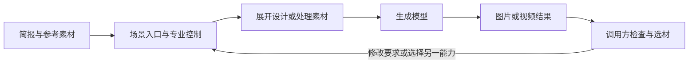
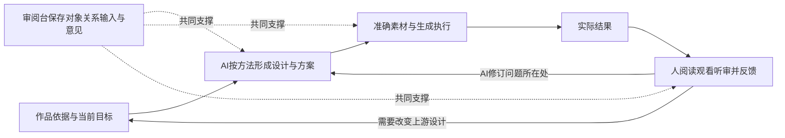

# Higgsfield 与本系统整体创作思路对比

本文回答：Higgsfield 怎样组织创作，与“李寄斩蛇”项目中人、AI 和审阅台共同完成影视创作的体系有什么异同，以及哪些做法值得借鉴。

资料截点：2026 年 10 月 12 日。Higgsfield 以指定会话的开放 API 研究、后续包装能力实验及报告修订为依据；本系统以当时已合入主干的作品、方法、工具和交付记录为依据。准确版本、来源及未验证范围见文末。

## 核心判断

**双方的共同思路，是把创作意图转成有专业依据、能交给生成模型执行的方案。最大的差异，是这些决定由谁完成、保存在哪里，以及围绕多大的工作单元持续修改。**

Higgsfield 将营销设计、广告构思、镜头导演和素材改造中的一部分决定，封装在场景接口里。用户或调用方表达意图、提供参考、选择少量控制项，平台展开设计并生成图片或视频。本系统则围绕一部作品逐步推进：AI 根据方法、作品依据和准确素材形成方案，人阅读结果、判断取舍和提出意见，审阅台保存共同上下文并校验交接。前者在已研究范围内更集中于完成一次场景任务，后者更集中于让多次创作和返修在同一作品中接得上。

**Higgsfield 最值得借鉴的，是用少量有意义的输入承接专业劳动。**实际预设不只添加一个风格词，还决定布局、数量、颜色和道具；Cinema 会补齐空间、运动和声音安排。这能减少从空白开始编写模型指令（Prompt）的负担，也会引入不适合本次任务的默认决定。本系统已有较完整的方法与上下文基础，下一步的价值在于让 AI 更可靠地完成这些判断，同时让人容易看懂和修改真正影响作品的选择。

**本系统应保留的，是作品依据、准确素材和反馈修订之间的连续关系。**这些关系支持查明“为什么这样做、改哪里、影响谁”，适合有前后场承接、人物状态变化和多轮意见的长篇创作。但保存了方法、引用和阶段记录，不等于已经产生好的镜头；当前也没有这部作品的实际镜头视频或完整成片。因此，这份比较支持组织方式与改进方向的判断，不能证明哪一方的最终作品质量更高。

## 比较对象与实际终点

这里的 Higgsfield，主要指原研究覆盖的 **Open Higgsfield 开放 API（供程序调用的接口）**：Marketing Studio、Ads Studio、Cinema Studio、Genjutsu、AI Influencer、Soul ID 及其生成与任务机制。网页入口和控制台用于理解这些能力怎样被组织；未研究的消费者功能、插件或编辑工具不计入结论。本文也不推断其内部 Agent 数量、推理模型或服务部署结构。

这里的“本系统”，包含四部分：外部 AI 执行者；故事项目的创作方法、专业资料与作者工具；通用审阅台的展示、评论和数据管理；实际图像、声音、视频生成通道。只比较两边的网页或接口，会遗漏本系统的主要创作工作。

两方现阶段的交付证据并不对称：原 Higgsfield 研究累计进行了 19 个主动请求，已有图片和短视频样本；本系统已形成故事结构、小说、锁定剧本及全剧视听设计，也已有图像和声音原件，但项目状态明确记载尚无作品镜头视频，剪辑成片流程也未作为已验证能力交付。Higgsfield 的短片样本不证明能完成本剧，本系统的全剧方案也不证明已能稳定生成全剧。这一边界直接限制质量和效率比较。[原研究报告](https://bytedance.larkoffice.com/docx/PO7XdafSioLvzuxEfbVcMqLynne)、[本系统当前制作边界](../../STATE.md#下一步与制作边界)

## 两种创作组织方式

### Higgsfield：从场景意图进入，平台代办一部分专业决定

Marketing Studio 用预设承接不同设计方向；Ads Studio 根据一份商业简报自动准备多个概念并出图；Cinema 接收镜头意图和可选摄影控制，未指定的控制交由导演流程选择。这些能力把专业表达压缩为较少的输入，再由包装层展开。[Marketing 契约](https://docs.higgsfield.ai/docs/models/marketing-studio-image/generate-and-edit)、[Ads 契约](https://docs.higgsfield.ai/docs/models/ads-studio/generate)、[Cinema 契约](https://docs.higgsfield.ai/docs/models/cinema-studio-4/generate)

原研究还观察到不同的复用方式：Genjutsu 按运动迁移、对象替换、风格化来组织素材改造；AI Influencer 组织角色外观选项并输出设定图；Soul ID 将训练图变成特定模型家族可引用的身份对象。它们分别复用设计结构、运动、外观或训练身份，不能统称为一种通用资产。[原研究的素材改造与角色章节](https://bytedance.larkoffice.com/docx/PO7XdafSioLvzuxEfbVcMqLynne)、[Soul ID 契约](https://docs.higgsfield.ai/docs/models/soul-id/create-character)

图中最后的检查和返修主要由调用方组织。已核查的 API 可以通过文件和任务结果连接，但没有充分证据表明它们自动维护完整作品的剧情依据、跨工具采用状态和长期意见闭环。这个结论只适用于本次研究范围，不能扩展为“Higgsfield 全产品没有项目协作能力”。

### 本系统：从作品目标推进，AI、人与系统共同维护工作

本系统的故事主线是采编资料、选择方向、结构与小说双向回修，再逐场形成影视剧本。生产制作从确定剧本进入，组织人物、场景、道具、歌曲和镜头，形成有明确用途的素材需求和当前方案；真实生成结果另作为候选保存。评论可以把问题带回当前方案、制作设计或上游作品。[故事与生产工作图源](../../content/production-approach.json)

这张图表达已建立的工作关系，实际结果节点仍受每次制作成熟度限制。审阅台负责保存和确定性校验；故事工具负责取得方法、保存阶段产物和交接。方法以 SKILL 文件包组织，说明所需输入、工作步骤、产物和自检，并按问题引用共用资料。读到的 `creative_method.py` 本身不调用创作模型，实际理解和写作由外部 AI 执行者完成。因而“有一个方法接口”与“Higgsfield 已把专业扩写放进生成服务”是不同程度的封装。[系统构想](../system-vision.md)、[方法实际入口](../professional-methods.md)、[作者检查点代码](../../scripts/creative_method.py)

## 按实际工作比较

| 比较维度 | Higgsfield 在研究范围内的做法 | 本系统当前的做法 | 对创作的影响 |
| --- | --- | --- | --- |
| 需求起点 | 商品/受众简报、镜头意图、已有素材改造目标 | 故事方向、准确作品与具体场镜的表达目标 | 两方起点不同。独立广告图不必先建故事结构；整剧制作需要跨阶段依据。 |
| 工作单位 | 一次生成、一个批次、一个参考改造任务；也有训练身份对象 | 作品版本、场镜设计、素材需求、当前方案及真实候选 | 本系统更强调多次工作如何共同构成作品；这也带来组织和维护成本。 |
| 专业知识的载体 | 预设、结构化选项、自动概念准备与导演扩写 | SKILL、按需共用知识、模板及 AI 实际判断 | 双方都复用知识。Higgsfield 将部分执行收进服务，本系统更多依赖外部 AI 遵循方法。 |
| 决策与控制 | 少量输入后补齐较多默认决定；部分中间结果能在控制台查看 | 方案、依据和实际参考可阅读、评论与修订 | 前者可降低操作成本；后者适合检查细节。两者都需控制无依据的新增内容。 |
| 身份与素材复用 | 文件参考、运动/风格改造、匹配模型家族的 Soul ID | 稳定实体、必要状态、唯一素材出处、准确候选及局部范围 | 本系统更明确“这个素材此时供谁做什么”；它仍不能保证模型保持身份或物理细节。 |
| 反馈与返修 | 调用方检查结果，改变简报、预设或参考后继续生成 | 评论对应原内容或原件，AI 回修相关方案/上游并保留回应依据 | 本系统便于长期回查和局部修改；是否减少返工仍需真实制作验证。 |
| 连续性与验收 | 各接口声明参考职责，结果仍需调用方检查 | 剧情阶段、人物状态、输入选择和跨镜交接有显式依据 | 本系统覆盖长程约束的设计更充分；两方都需要实际连看连听才能确认效果。 |
| 完成与交付 | 请求完成后取得图片/视频；部分流程把构思和渲染合在一次请求内 | 方案完成、生成完成、原件判断和下游选用分别处理 | 状态越清楚，越容易知道下一步缺什么；状态和记录数量本身不是创作价值。 |
| 扩展与代价 | 调用方可重组已有场景能力；内部默认和模型兼容性受接口约束 | 方法、专业资料和生成通道可以分别演进，作品上下文继续保留 | 本系统便于替换执行方式，但需承担方法、数据和工具一致性的工程成本。 |

表中本系统的主要依据为[创作交接](../professional-methods.md)、[方法执行契约](../managed-methods.md)、[当前制作与候选](../current-candidates/README.md)、[统一关系](../unified-relations/README.md)。Higgsfield 的流程和局限来自原报告与本轮复核的公开契约；“影响”列是据此作出的分析，不是测得的效率提升。

### 共同点比“都使用生成模型”更具体

第一，双方都在把抽象意图转成具体决定。Higgsfield 的导演扩写和本系统的镜头方法，都需要落实主体、空间、起点、运动和落点；只是专业判断进入执行的位置不同。

第二，双方都需要说明参考素材的职责。Marketing 增强模式区分商品图与可选人物图；本系统区分身份、状态、空间、构图、动作和声音参考。上传了文件不等于模型知道它该约束什么。[参考组织方法](../seedance-video-handbook.md#组织参考一份输入先说明一种职责)

第三，双方的真正循环都包含“得到结果后再判断”。Higgsfield 的自动构思可能不满足简报，本系统的文字方案也可能遗漏动作或采用不合适的姿势。正确的输入和明确的方法有助于减少歧义，但最终仍需用作品结果检验。

### 根本差异是哪些上下文留在下一次工作里

Higgsfield 可以很好地承接一个已明确的场景任务；在本次公开能力中，跨接口复用通常需要调用方重新组织素材和要求。本系统将“这个人是谁、此刻处于什么状态、这句词不能改、这份图用在哪里、意见针对什么”纳入长期协作上下文。它试图降低后续任务重新理解整部作品的成本。

因此，双方有组合空间：本系统可在符合输入与授权的条件下调用场景服务完成局部制作，再将真实结果纳入既有候选与审阅流程。不过，只有保存准确输入、实际返回和评价后，这种组合才成为可靠交接；把一个结果 URL 传给下一接口还不足以完成这件事。这是架构上的可行方向，本任务没有新增集成或调用验证。

## 三个具体场景

### 场景一：把一个明确目标展开为生成方案

**目标与输入。**原研究的 T09–T14 使用同一张白底蓝瓶图、同一段通勤广告简报和相同输出设置。T09 直接生成，后五次分别启用不同预设。T 编号只是研究样本编号，不是平台的创作对象类型。

**Higgsfield 的决定与产物。**T09 已形成窗景、背包和书本组成的通勤广告。预设进一步代办版面和道具选择：Ticket Stack 保留了没有价格的空票券；Old Way New Way 加入纸盒与胶囊形物体；Annotated Tilt 用同样两句文案反复填充标注卡。本轮复看这些图片，并读取 T10、T13、T14 的实际下游提示，确认上述选择在展开指令中已出现。因此，这些偏差不能全部归给生成模型。

**本系统的对应工作。**在[方法试用](../professional-methods/VERIFICATION.md#先做一个连续场再改方法)中，AI 从 E02/s004 的完整场次形成试镜，回读后发现“最后一粒米”可能被前后镜同时省掉，人物下一镜持纸包也缺少取起过程。修订先明确事件交接，再写模型方案。这里的正常路径是从观看目标决定哪些动作必须发生，而非先用镜头模板补满字段。

两者共同完成的是“从目标展开专业细节”。Higgsfield 更方便快速探索一种表达结构；本系统更强调这些细节是否服从准确作品和上下游。双方都可能为了维持结构而产生错误：预设填入无关道具，方法执行者也可能机械填场镜信息。

**失败后的处理。**营销图缺少真实卖点或对比对象时，合理做法是换相容预设、简化结构或先补充信息；不能让 AI 编出事实。场镜漏了必要动作时，应修正问题所在方案并连读相邻镜。前一项是从实验得出的建议，未重新生成验证；后一项有既有文本修订证据，仍未验证实际视频。建议本系统借鉴“少量意图驱动完整方案”，同时把适用条件写进已有方法，让 AI 自行识别模板不适用。

### 场景二：同一角色在后续镜头继续使用

**目标与输入。**需要保持身份，又允许衣着、干湿、伤势和持物随剧情改变。它要求区分稳定身份与阶段变化，不能只靠每次重复人物名字。

**Higgsfield 的路径。**AI Influencer 的 T19 以结构化外观选择、简报和水瓶参考生成肖像/全身设定图。本轮查看原图，确认产物形式和持瓶信息，也看到服装未完全遵循原要求。Soul ID 另提供训练后的可引用身份，适用于匹配的 SOUL 家族；它与一张设定 PNG 不是同一产品。原研究未训练 Soul ID，也未验证这条身份链跨全部模型复用。

**本系统的路径。**[唯一制作出处](../unique-origin/README.md#逐项处置及收益)明确将阿蘅的图像身份参考 M2544、声音 M2669 归属同一人物 EN002；EN、M 分别为实体与素材的稳定编号。湿袖与湿鞋分别保留必要状态及素材。后续镜头要选的是准确原件和适用范围，而非凭“这是阿蘅的图”继承其中全部姿势与持物。既有方法试用已经发现，湿衣图的抱书姿势不适合直接照搬为系米袋。

**决定、产物与修订。**Higgsfield 让调用方较快取得角色方向或模型专用身份；本系统维护“身份素材—当前状态—本镜用途”的业务关系，便于逐镜选择和反馈。两者作用不同，也可以互补。本系统的实体记录不是训练身份，Soul ID 也不能自动表达阿蘅此刻是否湿衣、持有哪一页歌本。

**失效与恢复。**训练身份不匹配目标模型时，需要选择兼容家族或改用经过核验的参考路线；相应效果仍待实测。本系统准确原件缺失时，应恢复可核实的原字节，不能用相似图替代历史目标。原项目已有恢复缺失组件的证据，但这仅证明来源恢复与引用正确，不能证明后续生成保持角色。值得保留的能力，是同时保存身份、阶段和用途；值得借鉴的能力，是把常用角色准备组织成较少、清楚的专业选择。

### 场景三：安排运镜，然后因反馈修改

**Higgsfield 的实际样本。**T17 要求蓝瓶在石台上保持静止，镜头在五秒内向右绕行，并选择单镜头和对应运镜。下游指令进一步组织首帧空间、主体数量、镜头轨迹、对焦、灯光和音频。本轮读取展开提示并查看 T16/T17 的抽帧联系表，确认自动展开确实发生，且抽样画面中保持了单瓶构图。

T16 直接调用 Seedance，T17 使用 Cinema，规格相同，但 T17 还使用了包装控制项。这不是只改变一个变量的实验；原研究未精确测量绕行角度或听审声音，本轮也未补做。因此，证据支持“平台代办导演决定”，不足以支持“Cinema 的画面一定更好”。

**本系统的对应路径。**先说明观众必须看懂什么、前后镜怎样接，再按[视频手册](../seedance-video-handbook.md#从一个镜头的目标开始)选择模式、参考职责和 Prompt。人物起点、定稿词句和物品归属不能由摄影风格覆盖。当前方案可以修订；提交后候选保存当时的方案、参数与真实参考，后续意见仍能回查原对象。[提交与意见契约](../current-candidates/README.md)

**收到修改意见之后。**如果只想改善运镜，理想结果是保住已经成立的剧情、人物、声音和准确素材，只重新决定镜头运动及其必要影响。Higgsfield 的生成接口更换要求后通常产生新片；Cinema 本身不是旧片编辑接口。调用方需另选适用的编辑能力并自行检查保持范围。本系统能够明确修改对象和保留旧候选依据，但 AI 仍须判断新运动是否容纳原动作、是否影响相邻镜；系统不能代替这个专业判断。

**正常与失败对照。**单主体、简单运镜适合较少输入。若改为开门后显露另一人物，或从手部近景抬到脸，就要核对后来显露的身份与空间；普通参考也不能冒充固定首帧。缺失原件或输入角色错配时应先补齐方案依据，再生成，不能用更多文字承诺绕过缺项。此处本系统的方案与检查机制已有依据，实片能否成立仍待真实生成和连看。

## 借鉴建议与取舍

以下是分析建议，未改变当前系统或新增执行任务。

### 1. 让 AI 围绕一个自然创作单元代办专业工作

优先尝试“这一场要让观众看懂什么”“这一镜必须保住什么”“这个角色准备哪一种用途”等真实工作输入。AI 读取准确方法和上下文后，完成必要的选择、方案、自检和交接，让人直接评价结果及少量关键取舍。已有方法入口、方案与评论已经能承载这条路线，无需先增加一套流程实体。

这借鉴了 Higgsfield 少量输入承接较多专业决定的优点，也保留本系统的可读中间方案。适用条件是准确输入已经可用、工作范围足够明确。验证时应比较同一工作单元是否减少重复表达和返工，是否保住原词、主体与承接；不能仅统计生成了多少字段。当前在途的抽取与视频方法任务可提供相关内容改进，具体收益须在其实际交付后判断。

### 2. 把模板的适用条件和退出方式交给 AI 判断

预设和模板应帮助形成决定。缺少卖点、对比对象或必要参考时，AI 应依据现有信息改用相容结构、简化表达或指出真正需要用户决定的缺口。场镜模板同样不能强迫每镜填满全部摄影、状态与声音维度。

本系统已经有按需知识、参考职责和未知项表达，可以在唯一方法正文中落实这种判断。可用“信息充分”与“缺少核心前提”两组样例检验：方案是否仍服务原目标，有没有新增未经提供的事实、重复信息或无用资产。营销预设的样本说明这项判断重要，但没有给出所有模板都适用的通用规则。

### 3. 保留可修订的中间方案，把追溯留在需要的位置

本系统已有当前方案、准确候选快照和原意见/回应关系，这是专业返修的基础。默认阅读应突出作品内容和当前选择；涉及争议、旧意见或来源问题时，再沿已有入口查证。AI 能自行核对的技术信息和重复条件，应由后台处理。

这项建议的判断标准，是用户能否从实际结果指出问题、读懂相应选择、继续修改，并在需要时准确回查。减少默认信息不能删除必要原件、历史意见或引用校验；也不应重新引入逐项审批，增加人的操作负担。[创作协作 Review 方法](../../skills/creative-system-review/SKILL.md)

### 4. 用实际结果检验“更好的方法”，把场景服务放在合适的位置

下一轮有效验证应选择一条输入已经准备好的小范围制作链，比较意图理解、方案、生成结果和反馈后的修订。关键指标是原要求是否满足、跨镜是否连贯、哪些人工劳动被减少，以及失效后能否有限返修；不是方法版本数、接口数或结构检查通过数。真实生成需要另核授权与额度。

若使用 Higgsfield，应按具体职责接入：Cinema 承接局部导演扩写，Genjutsu 承接已明确保持/改变目标的素材改造，角色能力承接适用的形象探索或训练身份。先验证一个用途和实际原件，再接到本系统已有对象与候选机制。无需为了复刻营销入口，把整剧创作改成一键广告批次；也不能因为本系统有长期上下文，就要求每个简单素材都经过全部故事阶段。

## 证据与判断边界

Higgsfield 的主要证据是原调研的公开契约、目录、实际请求和可见下游提示。原研究需求由产品设计反推，未做用户访谈；每个营销预设只有一个样本；视频按每秒两帧抽样，未听审音频；Object swap、Soul ID 训练、完整身份复用和广告投放效果未实测。这些限制使本文能解释决策组织和具体失效，不能估计质量胜率、转换收益或完整自动创作能力。

本系统的依据包括已交付的文档、准确数据与代码契约，以及原任务的试用、浏览器、恢复和发布记录。本轮没有重新操作整套页面、重演方法试用、读取全部活库或生成作品媒体。因此，本文将既有验证按原记录引用；当前源码与方法能说明机制，不能被提升为新的页面验收或成片验证。在真实影片完成前，跨镜身份稳定、表演、声音和整体节奏的优势都仍需实测。

本轮实际读取了原报告全文及实验记录，复看六个既有图像文件：T09、T19、两张营销预设合图、T16/T17 抽帧联系表；未听审音频，也未把联系表当作逐帧视频评测。没有新增生成、训练、配置修改、数据库发布或在线文档写入。

### 准确来源与版本

| 来源 | 本次采用范围与身份 |
| --- | --- |
| 原研究会话 | `01a12566-3e4d-76b3-804d-56f833a88b1d`，确认用户以需求、能力、架构及包装能力为研究主线。 |
| [Higgsfield 研究报告](https://bytedance.larkoffice.com/docx/PO7XdafSioLvzuxEfbVcMqLynne)与[本地证据入口](/Users/bytedance/codex-path/xyq/OpenHiggsfieldResearch/research/2026-10-12-packaged-capabilities/README.md) | 采用当前本地 XML 正文、整篇 revision 55 回读，以及 2.4 输入说明的 revision 63 局部验收；没有把旧 `lark-current.json` 当成 revision 63 整篇回读。本轮未重新抓取飞书在线正文。 |
| [12 项实验及展开提示](/Users/bytedance/codex-path/xyq/OpenHiggsfieldResearch/research/2026-10-12-packaged-capabilities/experiment-evidence.json) | T08–T19 的原请求与可见任务记录，结合[前轮证据](/Users/bytedance/codex-path/xyq/OpenHiggsfieldResearch/research/2026-10-10/README.md)理解累计研究。原研究文件保持只读。 |
| 本系统故事仓库 | 采用 `main` 提交 `dc8c5403e52c2fe784d556dd5d462f34c835d773` 的规则、作品、方法与交付资料。 |
| 通用审阅台 | 实例固定提交与只读源仓库均为 `09b6935eb4e012c934cb24539a04a17ca00ff353`；读取方法契约，并核对故事作者工具的分工。 |
| 官方在线契约 | 本轮读取 Marketing、Ads、Cinema、Restyle、Soul ID 页面，核对输入、封装范围与兼容边界；链接随相关判断给出。 |

正文还使用[方法试用](../professional-methods/VERIFICATION.md)、[唯一制作出处](../unique-origin/README.md)、[当前制作与候选](../current-candidates/README.md)、[影视叙事原理](../filmcraft/01-narrative.md)和[视频手册](../seedance-video-handbook.md)解释案例。各资料的历史数量和验收范围按其记录时点理解，不作为今天的全量进度。

截至本次账本读取，`task-20261012-0009` 的全剧抽取、`0011` 的视频方法与全剧 Prompt 重编、`0013` 的 SKILL 管理/文件历史/数据模型仍在途，未纳入已实现能力。本文提出的方向可作为阅读和后续取舍依据；这些任务的完成状态、实际制作效果与新的实现授权分别核对。
